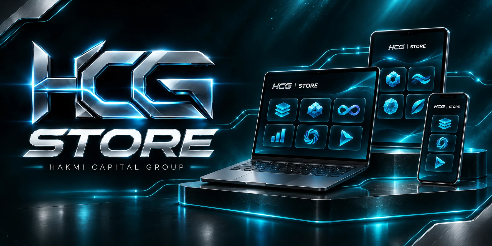
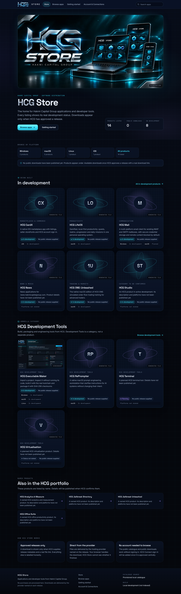

<p align="center">
  
</p>

# HCG Store (web storefront)

The web storefront for Hakmi Capital Group applications and developer tools. It is intended for
`https://store.hakmicapitalgroup.com`, but **that domain is not connected yet**. This project runs on
`localhost` and on any temporary preview host.

HCG Store is **not** the separately planned native *HCG AppStore* application. The two are kept apart
on purpose.

Screenshot of the running storefront (home page):



## Status (first working milestone)

| Area | State |
|---|---|
| Storefront: home, browse, product, release history, getting started, account & connections | Implemented |
| Search and filters (name/description/tags, platform, category, development status, release availability) | Implemented, synced to the URL |
| Versioned release model, current-release designation, Semantic Versioning ordering | Implemented |
| Dropbox downloads | Implemented. **No real release links have been supplied, so no product is downloadable yet.** |
| Catalogue | 14 products in a **provisional**, validated seed file. 0 releases. |
| HCG ERP catalogue provider | Read-only adapter ready; endpoint contract pending founder review |
| HCG Connect sign-in | **Not configured.** No sign-in is simulated. See [docs/HCG-INTEGRATION.md](docs/HCG-INTEGRATION.md) |
| Purchases, prices, licences | None. Not part of this milestone |

## Requirements

- Node.js **22.12 or later** (tested with 22.23) and npm 10.
- No accounts, API keys or external services are needed for development.

## Run locally

```bash
cd web-hcg-store
npm ci
npm run dev            # http://localhost:5173
```

Production build and local preview of exactly what will be deployed:

```bash
npm run build          # validates catalogue → type-checks → builds dist/ → scans dist/ for secrets
npm run preview        # http://localhost:4173 (serves the same security headers as production)
```

## Scripts

| Command | What it does |
|---|---|
| `npm run dev` | Development server with hot reload |
| `npm run build` | Catalogue validation, `tsc -b`, Vite production build to `dist/`, bundle secret scan |
| `npm run preview` | Serves `dist/` locally with SPA fallback and the CSP/security headers |
| `npm run typecheck` | TypeScript project check |
| `npm run validate:catalogue` | Validates `catalogue/*.json` (schema, unique IDs, references, Dropbox links, media files) |
| `npm test` | Unit and component tests (Vitest + Testing Library) |
| `npm run test:e2e:full` | Builds `dist/` and the fixture build, then runs Playwright end-to-end tests in Chromium |
| `npm run test:e2e` | Playwright only (requires both builds to exist) |
| `npm run build:fixture` | Builds `dist-fixture/` from the **test fixture** catalogue (labelled; never for production) |
| `npm run screenshots` | Regenerates `docs/screenshots/` (needs both builds) |
| `npm run check:secrets` | Re-runs the secret scan on `dist/` |
| `npm run verify:artifact -- "<dropbox link>"` | Checks a real release link's HTTP response, file name and optionally SHA-256 |
| `npm run check` | Validate + typecheck + unit tests + build |

Playwright uses the Chromium that matches `@playwright/test` 1.63. On a fresh machine run
`npx playwright install chromium` once.

## Project structure

```
web-hcg-store/
├── catalogue/                 Provisional seed data (products.json, releases.json): NOT UI code
├── public/brand, public/media Logo derivatives and real product screenshots (provenance in docs/ASSETS.md)
├── src/
│   ├── domain/                Taxonomy, zod schema, validation, semver, availability, search/filter
│   ├── downloads/             Download-provider interface + Dropbox link normalisation
│   ├── providers/             CatalogueProvider interface: local seed / HCG ERP (read-only)
│   ├── integrations/hcg-connect/  Auth configuration parser + adapter (refuses until approved)
│   ├── config/                Deployment config (origins, indexing) shared by build and app
│   ├── components/, pages/    UI
│   └── styles/                Design tokens and CSS (no CSS framework)
├── build/hosting-plugin.ts    Emits robots.txt, _headers, _redirects, sitemap (production only)
├── scripts/                   Catalogue validator, bundle secret scanner, artifact verifier
├── e2e/                       Playwright tests
├── tests/fixtures/            Clearly labelled fake catalogue used only by tests
├── deploy/                    nginx example; vercel.json lives at the project root
└── docs/                      Guides and reports (below)
```

The UI never reads JSON files directly. It asks a `CatalogueProvider`, so the local seed file can later be
replaced by the HCG ERP registry without changing components.

## Documentation

- [docs/CATALOGUE.md](docs/CATALOGUE.md): add a product, add a release, and add the **first real Dropbox release**
- [docs/DOWNLOADS.md](docs/DOWNLOADS.md): Dropbox rules, what a click means, and the public-link limitation
- [docs/HCG-INTEGRATION.md](docs/HCG-INTEGRATION.md): HCG ERP and HCG Connect path, configuration handoff, **proposed central changes for founder review**
- [docs/DEPLOYMENT.md](docs/DEPLOYMENT.md): build output, hosting, SPA fallback, env vars, headers, DNS/HTTPS, rollback
- [docs/ASSETS.md](docs/ASSETS.md): logo provenance and missing assets
- [docs/TEST-REPORT.md](docs/TEST-REPORT.md): what was run, results, and what was not run

## Ground rules baked into the code

- No invented releases, download links, prices, ratings, reviews, download counts or "live" activity.
- Development status and release availability are separate fields and are shown separately.
- The current release is an explicit pointer (`currentReleaseId`). It is never inferred from version
  strings, and history is ordered by Semantic Versioning, not alphabetically.
- Signing and notarisation are shown as "stated by HCG". The store never calls a file verified or safe.
- Clicking download means *download requested*, never "downloaded" or "installed".
- No secrets in frontend code. The build refuses credential-like `VITE_` variables and scans the output.
- Non-production builds are always `noindex`, with no canonical URLs and no sitemap.
