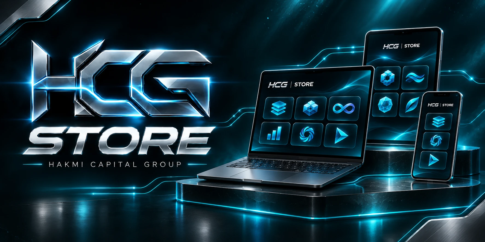
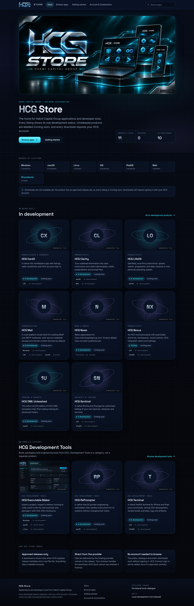

<p align="center">
  
</p>

# HCG Store (web storefront)

The web storefront for Hakmi Capital Group applications and developer tools. It is intended for
`https://store.hakmicapitalgroup.com`, but **that domain is not connected yet**. This project runs on
`localhost` and on any temporary preview host.

HCG Store is **not** the separately planned native *HCG AppStore* application. The two are kept apart
on purpose.

Screenshot of the running storefront (home page):



## Status

> **Downloads are not available yet.** No tool can be downloaded or installed until HCG Connect sign-in
> and server-side access enforcement are verified against HCG's live systems and the founder approves
> launch. Live payments are disabled. See [docs/ACCESS.md](docs/ACCESS.md).

| Area | State |
|---|---|
| Storefront: home, browse, product, editions, release history, getting started, account, library, checkout return | Implemented |
| Catalogue | 11 products with accurate descriptions and status (provisional seed). Editions and platform builds identified. 0 releases, so every product is *Coming soon*. |
| HCG Connect sign-in (server side: PKCE, sessions, restoration, logout, expiry, central revocation) | Implemented and tested against a mock of the live protocol. **Not configured:** HCG has not issued HCG Store's client yet. |
| Ownership | Asked from an entitlement authority on every request. HCG's ecosystem API is read-only and pending; a test ledger exists for test mode only. |
| Checkout | **Test mode only.** Signed provider events, idempotent ledger, refunds and subscriptions. No live provider is approved, and no prices are set. |
| Protected delivery | Private storage, checked on every request, behind a launch switch that is **off**. No public download URLs anywhere. |
| HCG Repo | Product pages linked both ways. Sileo payment-provider API implemented in the server and not enabled. See [docs/HCG-REPO.md](docs/HCG-REPO.md). |

## Requirements

- Node.js **22.12 or later** (tested with 22.23) and npm 10.
- No accounts, API keys or external services are needed for development or tests. A mock HCG Connect
  provider and a TEST payment provider are built into the test suite.

## Run locally

```bash
cd web-hcg-store
npm ci
npm run dev            # http://localhost:5173
```

Production build and local preview of exactly what will be deployed:

```bash
npm run build          # validates catalogue → type-checks → builds dist/ → scans dist/ for secrets → bundles the server
npm run preview        # http://localhost:4173 (static only: same security headers, no accounts)
npm run server:start   # http://127.0.0.1:8787 (the Store server; closed defaults, see .env.server.example)
```

Try the whole account and purchase flow locally in TEST mode (mock HCG Connect, TEST payments, TEST
files; nothing real is contacted or charged):

```bash
npm run build:fixture && npm run server:e2e   # then open http://127.0.0.1:4175/apps/fixture-quasar-shell
```

## Scripts

| Command | What it does |
|---|---|
| `npm run dev` | Development server with hot reload |
| `npm run build` | Catalogue validation, type checks (app and server), Vite build to `dist/`, bundle secret scan, server bundle `server-dist/` |
| `npm run preview` | Serves `dist/` locally with SPA fallback and the CSP/security headers |
| `npm run typecheck` | TypeScript project check |
| `npm run validate:catalogue` | Validates `catalogue/*.json` (schema, unique IDs, references, editions, no download URLs, media files) |
| `npm test` | Unit, component and server acceptance tests (Vitest + Testing Library) |
| `npm run test:e2e:full` | Builds `dist/` and the fixture build, then runs Playwright end-to-end tests in Chromium |
| `npm run test:e2e` | Playwright only (requires both builds to exist) |
| `npm run build:fixture` | Builds `dist-fixture/` from the **test fixture** catalogue (labelled; never for production) |
| `npm run screenshots` | Regenerates `docs/screenshots/` (needs both builds) |
| `npm run check:secrets` | Re-runs the secret scan on `dist/` |
| `npm run server:start` / `server:dev` | Runs the Store server (bundled / from source) |
| `npm run server:e2e` | TEST-mode server with mock HCG Connect and TEST payments, on port 4175 (used by e2e) |
| `npm run check:repo-mapping -- <HCG-repo dir>` | Verifies Store ⇄ HCG Repo links, editions and package IDs in both directions |
| `npm run check` | Validate + typecheck + unit tests + build |

Playwright uses the Chromium that matches `@playwright/test` 1.63. On a fresh machine run
`npx playwright install chromium` once.

## Project structure

```
web-hcg-store/
├── catalogue/                 Provisional seed data (products.json, releases.json): NOT UI code
├── public/brand, public/media Logo derivatives and real product screenshots (provenance in docs/ASSETS.md)
├── src/
│   ├── domain/                Taxonomy, zod schema, validation, semver, availability, search/filter
│   ├── providers/             CatalogueProvider interface: local seed / HCG ERP (read-only)
│   ├── account/               Client for the Store server (session, library, access, checkout); no tokens
│   ├── config/                Deployment config (origins, indexing) shared by build and app
│   ├── components/, pages/    UI
│   └── styles/                Design tokens and CSS (no CSS framework)
├── server/src/                HCG Store server: HCG Connect sign-in, sessions, entitlements, checkout,
│                              protected delivery, HCG Repo and Sileo APIs
├── server/data/               Server-only offers (prices) and protected-file registry (both empty)
├── server/test/               Acceptance tests, mock HCG Connect provider, TEST-mode e2e server
├── build/hosting-plugin.ts    Emits robots.txt, _headers, _redirects, sitemap (production only)
├── scripts/                   Catalogue validator, bundle secret scanner, Store ⇄ HCG Repo mapping check
├── e2e/                       Playwright tests
├── tests/fixtures/            Clearly labelled fake catalogue used only by tests
├── deploy/                    nginx example; vercel.json lives at the project root
└── docs/                      Guides and reports (below)
```

The UI never reads JSON files directly. It asks a `CatalogueProvider`, so the local seed file can later be
replaced by the HCG ERP registry without changing components.

## Documentation

- [docs/ACCESS.md](docs/ACCESS.md): sign-in, sessions, revocation, protected delivery, storage audit, **launch conditions** and the acceptance list
- [docs/PAYMENTS.md](docs/PAYMENTS.md): test-mode checkout, provider events, ownership, and native-app platform rules
- [docs/HCG-REPO.md](docs/HCG-REPO.md): Store ⇄ HCG Repo mapping, Sileo delivery and remaining work
- [docs/HCG-INTEGRATION.md](docs/HCG-INTEGRATION.md): what exists centrally, and the **request HCG needs to act on**
- [docs/CATALOGUE.md](docs/CATALOGUE.md): products, editions, releases and making a release deliverable
- [docs/DEPLOYMENT.md](docs/DEPLOYMENT.md): static build, the Store server, env vars, headers, DNS/HTTPS, rollback
- [docs/ASSETS.md](docs/ASSETS.md): logo provenance and missing assets
- [docs/TEST-REPORT.md](docs/TEST-REPORT.md): what was run, results, and what was not run

## Ground rules baked into the code

- No invented releases, download links, prices, ratings, reviews, download counts or "live" activity.
- Development status and release availability are separate fields and are shown separately.
- The current release is an explicit pointer (`currentReleaseId`). It is never inferred from version
  strings, and history is ordered by Semantic Versioning, not alphabetically.
- Signing and notarisation are shown as "stated by HCG". The store never calls a file verified or safe.
- Every download requires sign-in, and paid products also need an entitlement confirmed by the server.
  The browser never decides access; buttons are presentation only.
- A purchase counts only after the payment provider's signed event. HCG roles never imply ownership.
- No secrets in frontend code. The build refuses credential-like `VITE_` variables and scans the output.
- Non-production builds are always `noindex`, with no canonical URLs and no sitemap.
