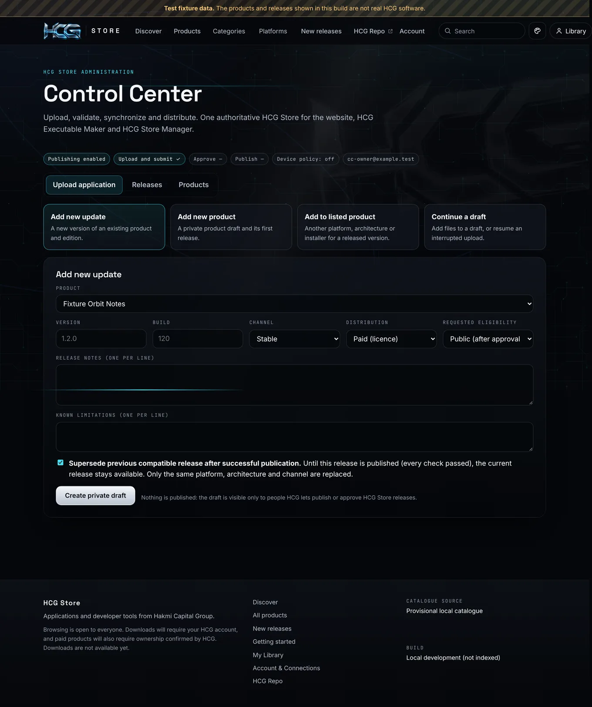
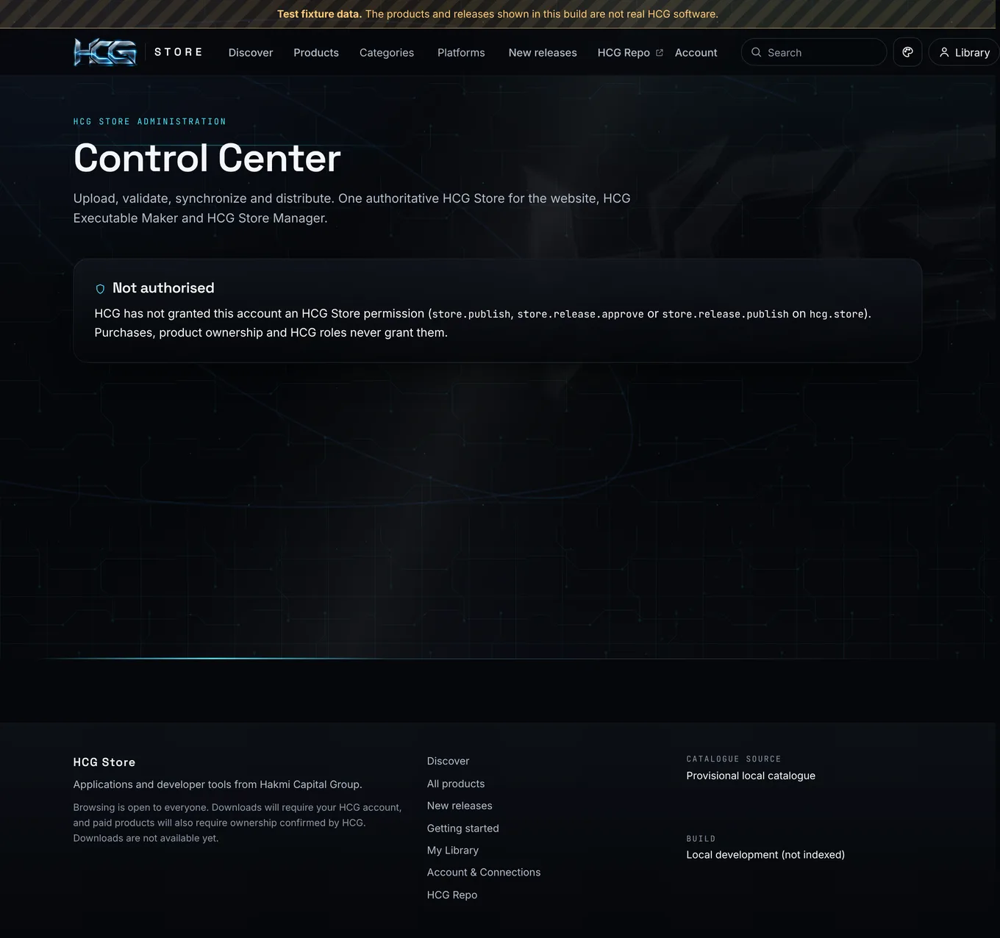
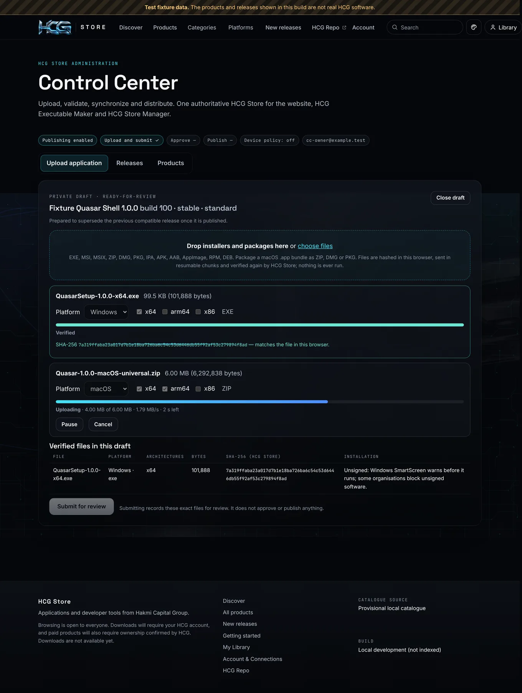
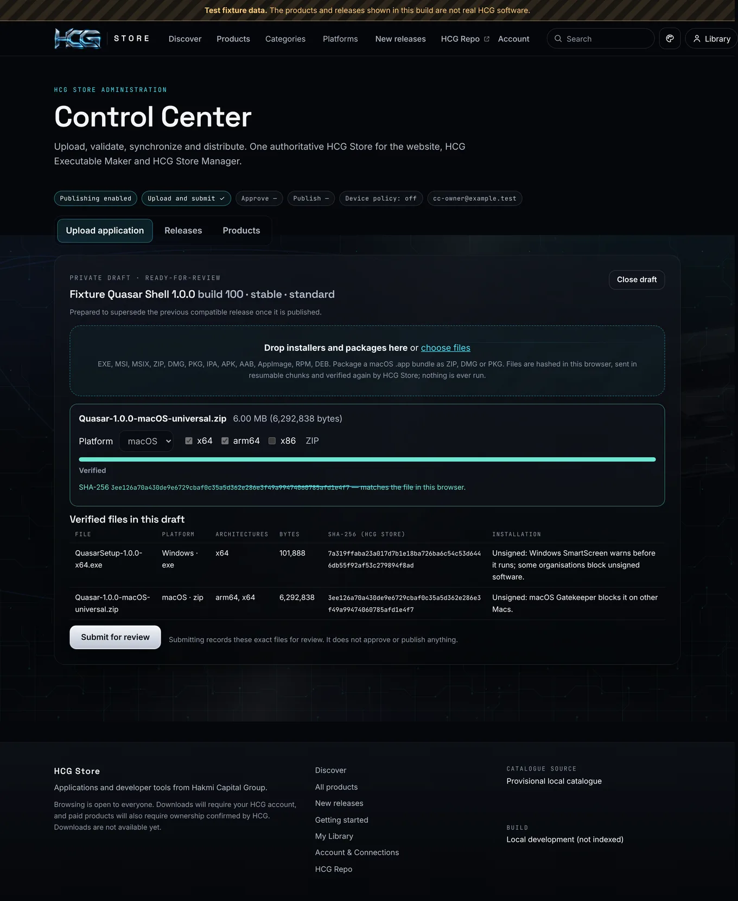
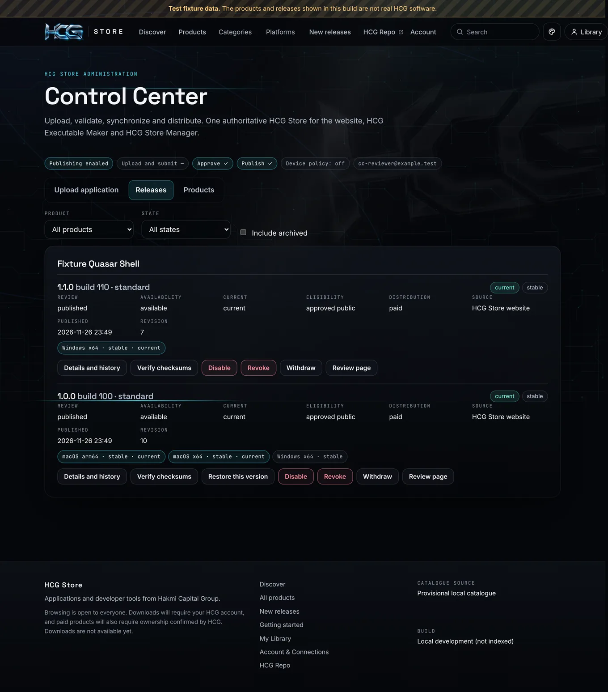
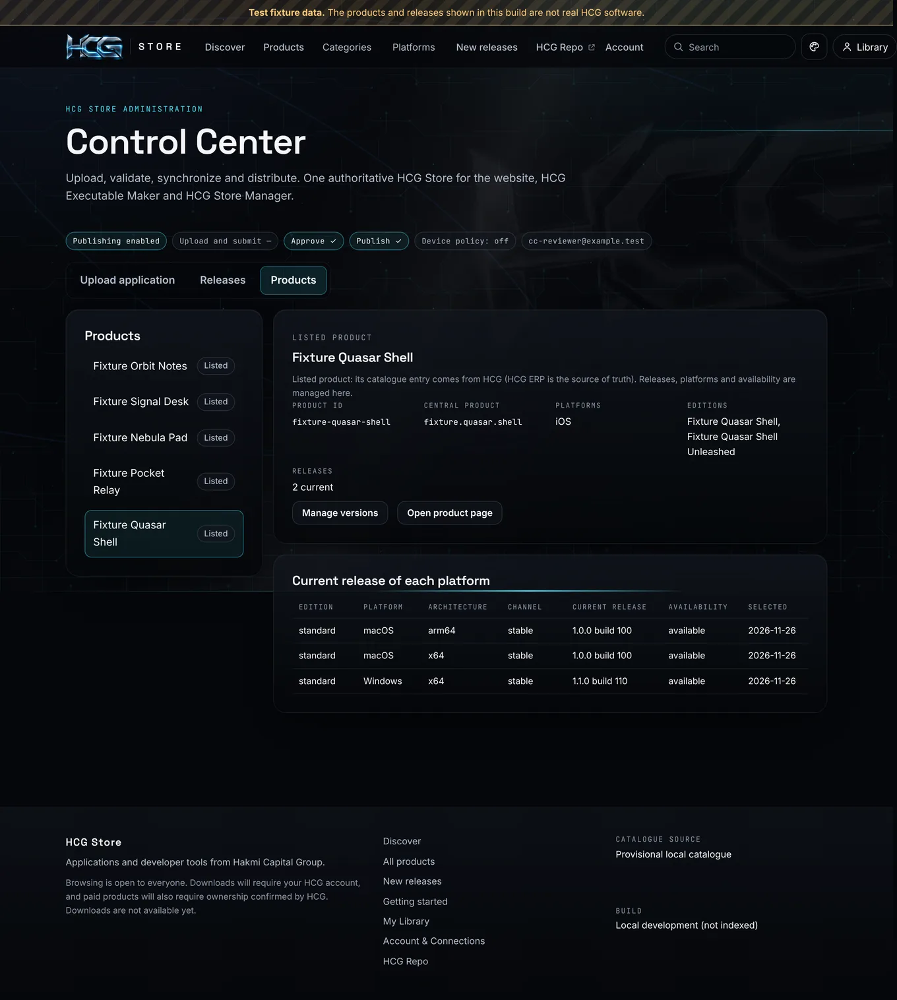
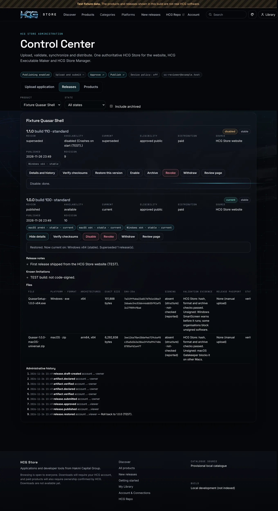
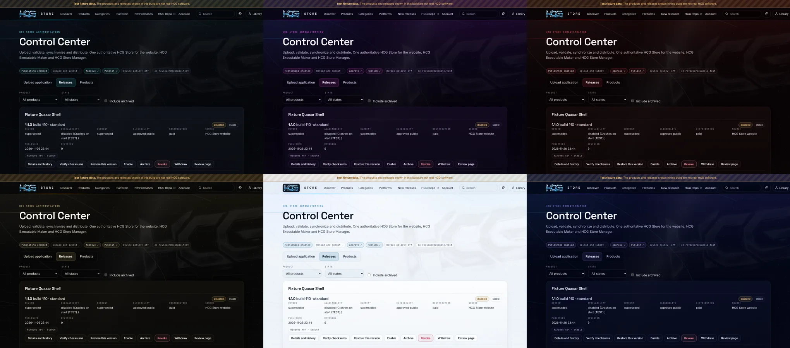

# HCG Store administration: Control Center, direct uploads and release lifecycle

The Control Center (`/control-center` on store.hakmicapitalgroup.com) uploads, manages and updates software through
the HCG Store website itself. HCG Executable Maker and HCG Store Manager use **the same versioned management API and
the same records**. A draft uploaded on the website is the same draft in both desktop apps, and the reverse is also true.
Nothing here needs GitHub Actions.

## 1. Who may do what (server-side, on every request)

HCG Store keeps no roles and no permission table. On every request it asks HCG's entitlement authority
(`/check`, the caller's own HCG token) for the personal grant the operation needs, on HCG Store's central product
`hcg.store`. These are the permissions that already exist in HCG's contract; **no new central permission was
introduced**:

| Operation | Needs | Where |
| --- | --- | --- |
| List products, create Store draft products, create releases, upload, attach Release Passports, submit | `store.publish` | website or desktop app |
| Approve | `store.release.approve` | browser only |
| Publish, supersede, restore (rollback), re-enable a published release | `store.release.publish` (configured key) | browser only |
| Disable (stop downloads) | any of the three | website or desktop app |
| Archive, withdraw | `store.publish` or `store.release.approve` | website or desktop app |
| Revoke (final) | `store.release.approve` or `store.release.publish` | browser only, typing the version |

Rules that do not change:

- **An Owner or Administrator classification grants nothing by itself.** An HCG role, organisation membership, a
  purchase or a product licence is never a Store permission. The acceptance test signs in an account whose HCG
  role is `admin` with no Store grant: the server refuses every upload and every change.
- The page only shows controls. `GET /api/v1/publishing/me` tells the website what HCG allows, and the server
  authorises every operation again. A hidden button, a changed page or a client flag grants nothing.
- Separation of duties for public release stays: whoever created or submitted a release may not approve or publish
  it, unless a founder-operated release exception covers that exact release and files (release-exceptions.ts).
- Production: `HCG_STORE_PUBLISHING=uploads`. Uploads, drafts and submission work. Approval, publication,
  supersede, restore and every customer download stay off until each is separately approved
  ([ACCESS.md](ACCESS.md)). Payments stay `none`.

## 2. The four operations of *Upload application*

| Operation | What it creates | Effect on what customers get |
| --- | --- | --- |
| **Add new update** | A new release (version, build, channel) of an existing product and edition. *Supersede previous compatible release after successful publication* is ticked by default. | None until the release is approved and published. Then it replaces only the same platform, architecture and channel. |
| **Add new product** | A **Store draft product** (id, name, summary, platforms, editions), then its first private release. | None. A draft product is Store-only. It is never a central HCG product, entitlement or price, and it cannot be approved for public release until HCG registers it (HCG ERP) and it is in the catalogue. |
| **Add to listed product** | A new release with the **same version** as a released one (its own build), carrying another platform, architecture or installer. | Published bytes are immutable, so the new installer gets its own release identity and its own review. Its new targets become current; existing platforms are untouched. |
| **Continue a draft** | Adds files to a draft, or resumes an interrupted upload. | None. |

### Upload pipeline (the existing one, not a second system)

1. The browser hashes the file (SHA-256, incrementally, without loading it into memory): `src/admin/sha256.ts`.
2. `POST /releases/:id/artifacts` declares name, platform, format, architectures, exact size and SHA-256. The
   server checks the format and extension list, the storage quota, and duplicate bytes or names in the release.
3. The file goes in `Content-Range` chunks to a short-lived upload URL scoped to that one file. Progress, speed and
   time left are shown. Pause keeps the bytes and Cancel removes the file. Each chunk is retried with back-off; on
   doubt the Store says where to resume (it cuts off a broken chunk), and an expired URL is renewed.
4. A journal in the browser remembers unfinished uploads. After a reload or crash, choosing the same file resumes
   it, and the file must have the same size and SHA-256.
5. `POST /artifacts/:id/complete`: HCG Store re-hashes what it received and checks the format and archive structure
   (magic bytes; ZIP-family entries for absolute paths, `..`, symlinks, encryption and bomb ratios). It decides the
   file's kind from the content and moves the file to immutable storage (`0444`, never overwritten or deleted).
   **Nothing is executed or extracted.** A mismatch or a renamed file is rejected with the reason.

Formats: EXE, MSI, MSIX, ZIP, DMG, PKG, IPA, APK, AAB (staff-only, never offered to customers), AppImage, RPM,
DEB. A macOS `.app` bundle must be packaged as ZIP, DMG or PKG. Jailbreak `.deb` packages go to HCG Repo (Sileo)
with the `hcg-repo` destination and the package-mapping checks in [HCG-REPO.md](HCG-REPO.md). Website uploads are
recorded honestly as **manual uploads** (no build evidence claimed); a matching HCG Release Passport can be attached.

## 3. Release lifecycle: three separate dimensions

| Dimension | Values | Stored in |
| --- | --- | --- |
| Review / publication | draft · uploading · validation required · ready for review (derived from the files) · submitted · approved · published · superseded · withdrawn | `pub_releases.status` |
| Availability | available · disabled (restorable) · archived (hidden, kept) · revoked (final; a database trigger refuses any way back) | `pub_releases.availability` |
| Currency | current · superseded · not current | `pub_current` (per target) |

The Release Manager shows one label (for example `current`, `disabled`, `ready-for-review`) and all three dimensions
separately. Every change bumps the release's `revision` (database triggers) and is written to the hash-chained,
append-only publishing audit.

## 4. Current-release resolution

A **distribution target** is (product, edition, platform, architecture, channel). Each verified customer file of a
release defines its targets. A universal macOS ZIP serves `macos/arm64` and `macos/x64`, and an EXE and an MSI of the
same build share `windows/x64`, so several installer formats of one release coexist.

`pub_current` holds the **explicitly selected** current release of every target. It changes only through:

- **Publication.** Targets with no live current release switch to the new release. Targets that already have
  one switch only when *supersede previous compatible release* was chosen (prepared on the draft or confirmed at
  publication).
- **Supersede.** A published release becomes current on its targets.
- **Restore (rollback).** An earlier published release becomes current again on every target it serves.

Version numbers never decide what is current, and a newer version is not automatically current. Consequences, each
covered by a test:

- A macOS update does not touch Windows, ARM64 does not touch x64, and beta does not touch stable.
- A replaced release that is still current on another platform stays `published` (for example 1.0.0 still
  serving macOS). A release that is current nowhere becomes `superseded`.
- Customers are offered and served only files of releases that are current on their target, published, approved
  for public delivery and `available`. Superseded, disabled, archived, revoked and withdrawn releases leave the
  product page, `/api/v1/downloads`, Sileo and the public release resolution. They stay in the administrative
  history with their files.
- The public release-resolution API (`/api/public/v1/release-resolution/:product`) is computed live from
  `pub_current`, so availability changes appear without redeploying the website.

The catalogue's static `currentReleaseId` (`releases:sync`, approver's explicit "make current") is unchanged and
separate. It is what the static GitHub Pages storefront shows.

### Safe replacement (atomic)

Publishing first re-hashes every stored file of the new release. If any differ, publication is refused, recorded
(`release.publication-refused`), and **nothing changes**: the previous release stays current and downloadable. Then a
single SQLite transaction makes the release `published`, switches its targets, marks the fully replaced releases
`superseded`, starts publication-anchored free testing windows and expires outstanding download links to superseded
files. It commits all of that or none of it.

### Stopping a release

**Disable**, **revoke**, **withdraw** and **supersede** expire the short-lived download links already issued for
those files, and every link is re-authorised when it is used anyway. A person holding a stopped link gets 410 with the
reason. Limits: bytes already streamed (or a copy someone kept) cannot be recalled, and HCG Repo removes a withdrawn
package on its next sync of `/api/v1/repo/releases`.

## 5. Shared management API (v1, additive)

Base `/api/v1/publishing`. Browser: Store session cookie plus `X-HCG-CSRF`. Desktop: `Authorization: Bearer <HCG
Connect access token>` from an allow-listed client. Changes accept `If-Match: "<revision>"`; a stale copy gets
**409 `revision_conflict`** and nothing is overwritten. Existing Executable Maker and Store Manager calls are
unchanged. New fields are additive, and clients ignore unknown keys.

| Purpose | Method and path |
| --- | --- |
| Capability discovery | `GET /capabilities` (formats, limits, storage, `operations`, `lifecycle`, concurrency rule, and the flags below), `GET /me` (permissions now; CSRF token for browsers) |
| Authorised catalogue | `GET /products` (may publish) · `GET /products?scope=review` (may publish, approve or publish releases). Each product carries `slug`, `summary`, `category`, `developmentStatus`, `visibility`, `platforms[]`, the **official** `icon` and `cover` (HCG Store's public media URLs; concept artwork is never returned as official; `null` when there is none), `currentReleaseId` and `productUrl` |
| Product lookup and editions | `GET /products/:id` (metadata, editions, current release of each target, release counts) |
| Product drafts | `POST /products` (`id`, `title`, optional `metadata`, or Distribution Studio's `description`, `category`, `platforms`; all stored in the same revisioned metadata) · `PATCH /products/:id` (draft products only; If-Match) |
| Releases and version history | `POST /releases` (incl. `supersedePreviousOnPublish`, or Distribution Studio's `publicationRequest: { makeCurrent, supersedePrevious: "none" \| "compatible", note? }`) · `GET /releases?productId=` · `GET /releases/:id` (files, validation, passports, targets, lifecycle, audit) · `GET /manager?productId=&include=archived` · `GET /compare?from=&to=` |
| Uploads | `POST /releases/:id/artifacts` → `PUT /publishing-upload/v1/:token` (Content-Range) · `POST /artifacts/:id/upload-url` (resume) · `POST /artifacts/:id/complete` · `DELETE /artifacts/:id` |
| Release Passport | `POST /artifacts/:id/passport` |
| Review | `POST /releases/:id/submit` · `/approve` · `/publish` (`supersedePrevious`) |
| Lifecycle | `POST /releases/:id/disable` · `/enable` · `/archive` · `/revoke` · `/withdraw` · `/supersede` · `/restore` |
| Requests (desktop apps) | `POST /releases/:id/requests { action: disable \| enable \| restore \| supersede \| make-current, reason, confirm: <version> }` → 202. Recorded in the audit and shown in Release Manager and on the review page; it changes nothing. Refused (409) when it cannot apply (for example restoring a release that is already current, or anything about a revoked release). |
| Integrity | `POST /releases/:id/verify-checksums` |
| Synchronisation | `GET /changes?since=<seq>` (audited changes after a sequence number; clients refetch what changed) |

Capability flags (`capabilities.capabilities`), all additive; a flag a Store does not send means "not available":
`products`, `drafts`, `uploads`, `resumableUploads`, `passports`, `submission`, `approval`, `publication`,
`publicDelivery`, `offers`, `productMetadata`, `publicationRequests`, `availabilityRequests`, `supersedeCompatible`,
`withdraw`, `availability`, `restore`, `perTargetCurrent`, `revisions`, `changes`.

Compatibility: HCG Executable Maker 0.4.0 (its `HcgStoreClient` on Maker main) works unchanged. Every request it makes
is covered by a test with its exact shapes (`server/test/distribution-studio.test.ts`). Maker's Distribution Studio
(branch `feature/distribution-studio`) sends `publicationRequest`, the draft product fields and `/requests` only when
the matching flag is present, so it works against this Store and against older ones.

`POST /releases/:id/publish` accepts `scope: "compatible"` (how supersede always works now). `scope: "edition"` is
refused with `400 edition_scope_removed`: retiring every published release of an edition retired unrelated platforms,
architectures and channels.

Coordination for the desktop teams (Executable Maker, Store Manager, the future Executable Maker Unleashed):

1. Read `revision` from every release and product. Send `If-Match` on changes, and on 409 reload and show the
   other client's change.
2. Poll `GET /changes?since=` to stay in sync (the website does this every 15 s on the Releases tab).
3. Show `lifecycle.label`, `availability` and `targets[].current`. Do not infer current releases from versions.
4. Offer `supersedePreviousOnPublish` when creating an update.
5. Approve, publish, supersede, restore and revoke are browser-only. Desktop apps open the Control Center, or the
   review page (`reviewUrl`).

## 5a. Complete release administration on the website

The website is a full administrative client of HCG Store and stays one: it needs no desktop application. HCG Store
Manager and HCG Executable Maker are additional clients of the **same** endpoints, permissions and hash-chained audit;
there is no second approval database. Every step is checked again on the server, with HCG's permissions read live.

| Step | Where (Control Center → Releases, Release readiness) | Server |
|---|---|---|
| Create a draft · upload files (resumable) · declare signing as checked on a Mac/PC, with evidence | Upload application | `POST /releases`, `POST /releases/:id/artifacts`, upload, `POST /artifacts/:id/complete` |
| Inspect files, validation, signing, notarization, Release Passports | Release readiness → Files | `GET /releases/:id/readiness` |
| Edit release details (notes, limitations, requested eligibility) — a submitted or approved release returns to draft | Edit release details | `PATCH /releases/:id` (store.publish) |
| Submit for review | Submit for review | `POST /releases/:id/submit` |
| Record the Founder's own exception | Record founder exception | `POST /releases/:id/founder-exception` (browser only) |
| Approve · publish | Approve · Publish | `POST /releases/:id/approve` · `/publish` (browser only) |
| Request changes (back to draft) · reject (withdrawn, reason recorded) | Request changes · Reject | `POST /releases/:id/request-changes` · `/reject` (store.release.approve) |
| Current version per platform · supersede · roll back · disable · withdraw · revoke | Release card actions | `/supersede`, `/restore`, `/disable`, `/withdraw`, `/revoke` |
| History and audit | Details and history | `GET /releases/:id` (audit) |

**Release Readiness Inspector.** For each release under review it shows the status, artifact verification, signing,
notarization, the three HCG permissions of the person looking, separation of duties, and every step with
*Available*, *Done* or *Not available*. A step that cannot run is shown disabled **with its reasons** and, where one
exists, the action that resolves it (e.g. *Submit for review*, *Record founder exception*, *Add release notes*).

**The Founder's own exception (website).** The person who created or submitted a release may approve and publish it
for the public only with a founder-operated exception for that exact release and those exact files. On the website,
the Founder records it personally when, and only when:
- HCG's `/me` reports the Founder policy (`founder_owner_all_products`) and `/access` reports HCG Store as
  founder-owned for that account — never an e-mail address, a Store profile or anything the browser sends;
- the account holds store.publish, store.release.approve and store.release.publish;
- the release is the account's own, not yet published, with verified files and no upload in progress;
- the files meet the mandatory signing requirements for public delivery (below);
- the person types the version, gives a reason, confirms the files digest they reviewed and acknowledges that it is
  not an independent review.

It is recorded with the Founder's account, the release, every file's SHA-256 and the files digest, the reason, the time
and the central basis; approval and publication carry `governance.independentReview: false`. No reviewer is invented.
Everyone else (including staff holding all three permissions) keeps separation of duties: another person approves.
`HCG_STORE_FOUNDER_WEB_EXCEPTIONS=off` limits exceptions to the operator path (`mode=release-exception`).

**Mandatory signing for public delivery (never changed by an exception).** Every macOS file customers would receive
must be Developer ID signed and notarized (HCG Store sees the signature seal in the file; notarization is reported by
the uploader's check — HCG Executable Maker, a CI import verified by HCG Store, or the website uploader with
evidence); iOS and Android device builds must be installable. Unsigned files can still be approved for private or
internal testing.

**Diagnosis.** `mode=release-diagnosis` (deploy workflow) prints every release, its files, exceptions, current targets
and the recent audit from the production database, opened read-only; accounts appear only as one-way references.

## 6. Product Manager

- **Listed products**: the catalogue entry comes from HCG (HCG ERP is the source of truth; catalogue files are
  public). The Control Center shows editions, platforms and the current release of every target, and manages their
  releases. Editing a listed product's metadata here is refused (`409 catalogue_product`), because making the Store a
  second authority for catalogue data needs a founder decision (section 9).
- **Store draft products**: name, summary, description, categories, platforms, editions, system requirements,
  documentation and support links (https only), visibility (private or internal). They are revisioned and
  conflict-safe.
- **Manage product**: product pages show this button only when `GET /me` reports an HCG Store permission. It opens
  the product in the Control Center.

## 6a. Payment provider and developers

Control Center has two more tabs:
- **Payment provider:** HCG Store as HCG Repo's Sileo and Zebra payment provider. It covers the profile, availability,
  payment mode and repositories, a health inspector, the exact Sileo responses, the repository-package distribution
  channel and the commerce audit.
- **Developers & sales:** third-party developers, product ownership, commission agreements, and a sales report built
  from the purchase records. Payouts are off.

Reading needs an HCG Store staff permission or HCG's Founder policy. Changes need the Pricing and Offers permission or
the Founder policy. See [SILEO-PAYMENT-PROVIDER.md](SILEO-PAYMENT-PROVIDER.md).

## 7. Security

| Control | Implementation |
| --- | --- |
| Authentication | HCG Connect: Store session (HttpOnly cookie, re-confirmed centrally) or bearer token (JWKS signature, issuer, expiry, allow-listed `client_id`; revocation via `/check` on every action) |
| Authorisation | Central permission per operation, on every request; never cached |
| CSRF | Same-origin check **and** a per-session token (`HMAC(secret, session-hash)`) in `X-HCG-CSRF` on every browser change. The review page embeds it, and its inline scripts now run under a per-response CSP nonce (before, its buttons were blocked by its own CSP in real browsers). |
| Rate limits | Per person: `HCG_STORE_ADMIN_RATE_PER_MINUTE` (default 300). Upload chunks: 1200 per minute per file. Over the limit: 429. |
| Files | Private storage. Immutable once verified, never executed. Every URL is short-lived, scoped to one file and person, and re-checked at use. |
| Concurrency | Revisions and If-Match, conflict detection, append-only audit |
| Secrets | None in the browser. The page never sees an HCG token, and nothing is logged with a token. |

## 8. HCG UEM readiness (not active)

`HCG_STORE_DEVICE_POLICY` accepts only `off`; any other value refuses to start. `GET /me` reports
`devicePolicy: off`. The operations a future device policy would cover (Administrative or Sovereign Devices) are
publish, supersede, restore, revoke and enable. They are already the browser-only, publication-permission
operations, so a device check slots in at that single point. No device restriction is introduced until HCG UEM is
implemented, reviewed and explicitly approved.

## 9. Not built yet (decisions needed)

- **Media library** (icons, banners, screenshots) and **editing listed products' metadata from the website**. Both
  would make HCG Store a second authority next to the catalogue and HCG ERP. Proposal for founder review: store
  approved overlays in HCG Store with the same draft/review/publication steps as releases, and have the catalogue
  pipeline (`releases:sync`) read them. Not built until decided.
- **Central product registration** stays with HCG (ERP). A Store draft never creates a central product.

## 10. Evidence

Server acceptance suite `server/test/admin-lifecycle.test.ts` (real server, mock HCG Connect, TEST ledger):

| # | Criterion | Test |
| --- | --- | --- |
| 1–2 | Customers and administrators without a Store grant cannot upload or administer; CSRF and cross-site refused | `1–2. …` |
| 3–6 | Owner selects a listed product, uploads an EXE and a ZIP, an interrupted upload resumes at the last good byte, server SHA-256 matches; a renamed file and duplicates are refused | `3–6. …` |
| 7 | Same draft (same revision and SHA-256s) for the website, Executable Maker and Store Manager; desktop additions appear on the website; ordered change feed | `7. …` |
| 8–10, 13 | Update prepared; tampered bytes refuse publication and leave 1.0.0 current; publication switches Windows atomically; macOS, ARM64 and beta unaffected; without supersede nothing is taken over | `8–10, 13. …` |
| 11, 12, 14 | Superseded leaves customer downloads; disabled is undownloadable (issued link → 410); re-enable needs the publication permission; history, archive and staff review access | `11, 12, 14. …` |
| 15 | Rollback restores 1.0.0 on all its targets in one step; revoked can never come back | `15. …` |
| 16–17 | Uploads mode: website uploads privately; approve, publish and restore refused; no customer delivery; production `fly.toml`: payments `none`, downloads `disabled`, publication key absent; device policy cannot be switched on | `16–17. …` |
| — | Revisions and If-Match across website and Store Manager; draft product editing; listed products refused | `concurrent clients …` |

Distribution Studio (`server/test/distribution-studio.test.ts`): official metadata and artwork in the product list;
descriptive draft products; a beta x64 update with `supersedePrevious: "compatible"` replaces only the beta x64 release
(stable and ARM64 stay current); the edition-wide scope is refused; failed publication supersedes nothing; requests are
recorded, validated against the lifecycle and change nothing; uploads mode keeps approval off; the full Executable Maker
0.4.0 request sequence, including an interrupted and resumed upload.

Migration 10 (`server/test/migration.test.ts`): the v7 production-shaped backup upgrades without losing a row. A v9
database with published releases gets one current release per target (newest publication), AABs and unpublished
releases excluded; revoked is final and revisions bump. Migration 11 (Distribution Studio: `pub_releases.publication_request`)
upgrades a database at 9 (production today) or at 10 without losing a row.

Browser (`e2e/admin.spec.ts`, Chromium, TEST Store): genuine Windows PE executables (x86-64 and ARM64 launchers) and
a 6 MB macOS app ZIP uploaded through the website; the ZIP upload interrupted, the tab reloaded and the upload resumed
from the bytes the Store kept; SHA-256 shown and matching; the same draft read with a desktop token; a second person
approves and publishes; a Windows update supersedes only Windows; disable and rollback in the browser; a customer is
offered exactly the restored files; *Manage product* only for administrators; all six themes.

| | |
| --- | --- |
|  |  |
|  |  |
|  |  |

Screenshots come from the TEST Store with fixture products (labelled as such on every page). They are not production
data.
